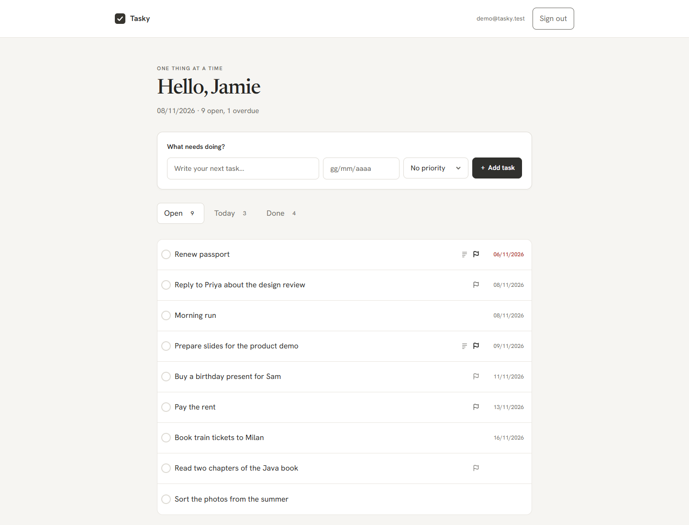
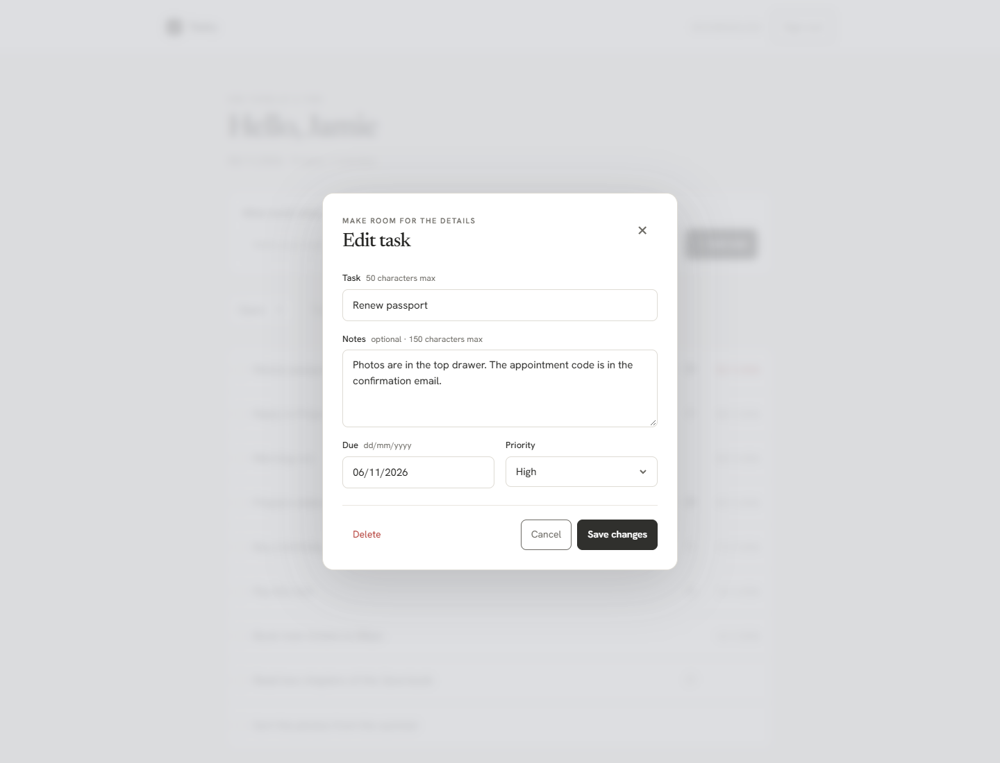

# Tasky

A small task list: sign in, add tasks with a due date and a priority, tick them off.


<br>
[](https://github.com/krishnapilato/tasky/actions/workflows/build.yml)
[](https://github.com/krishnapilato/tasky/actions/workflows/security.yml)
[](https://github.com/krishnapilato/tasky/actions/workflows/pages.yml)

**[Live demo](https://krishnapilato.github.io/tasky/)** · runs in the browser with sample data, no sign-up needed

[Quick start](#quick-start) · [Features](#features) · [Stack](#stack) · [API](#api) · [Security](#security) · [Checks](#checks-and-tests) · [Layout](#project-layout)

| The task list | Editing a task |
| --- | --- |
|  |  |

## Quick start

Needs JDK 27 and Maven.

```bash
mvn package
```

```bash
java -jar target/tasky.jar
```

Open <http://localhost:8080> and click **Try the demo account**.

- **Port:** set `PORT` to use another one.
- **Data:** in memory, filled from [`seed.json`](src/main/resources/web/data/seed.json) at every start. A restart resets everything.
- **Docker:** `docker build -t tasky .` then `docker run --rm -p 8080:8080 tasky`

## Features

- Sign up, sign in, sign out
- Add, edit, finish and delete tasks
- Due dates as `dd/mm/yyyy`, overdue tasks in red
- Three priority levels
- Filters: open, due today, finished
- Validation in the browser and again on the server: title up to 50 characters, notes up to 150, no due dates in the past
- Keyboard focus, field errors, mobile layout, no double submits, confirmation before deleting

## Stack

| Layer | Choice |
| --- | --- |
| Server | Java 27, [Javalin](https://javalin.io) 7 on Jetty, virtual threads |
| Data | [JDBI](https://jdbi.org) 3, in-memory H2 |
| JSON and passwords | Jackson 3, password4j (Argon2id) |
| Frontend | Pico CSS, Alpine.js CSP, Valibot, native dialogs and JS modules |
| Build | Maven only: the frontend is served as pinned files, no bundler at runtime |

No Spring. The reasons for this and other choices are in [docs/decisions.md](docs/decisions.md).

## How the demo runs without a server

GitHub Pages only serves files, so the Java code cannot run there.

1. The page asks `api/account`.
2. The Java server answers it. On Pages, the same path is a static file saying `"demo": true`.
3. In demo mode the page uses [`demo.js`](src/main/resources/web/js/demo.js): same routes, same messages, data in `localStorage`.

Both versions load the same `seed.json`, and the UI tests run against both.

## API

| Method | Path | What it does |
| --- | --- | --- |
| `GET` | `/api/account` | Who is signed in |
| `POST` | `/api/account/register` | Creates an account and signs in |
| `POST` | `/api/account/login` | Signs in |
| `POST` | `/api/account/logout` | Signs out |
| `GET` `POST` | `/api/tasks` | Lists or adds tasks |
| `PUT` `DELETE` | `/api/tasks/{id}` | Changes or deletes a task |

- Errors look like `{"message": "..."}`.
- `POST`, `PUT` and `DELETE` need the header `X-Tasky-Request: 1`.
- `POST` and `PUT` bodies must be `application/json`.
- `X-Time-Zone` (an IANA zone) sets which day is "today" for date checks. Default: `Europe/Rome`.

## Security

| Area | What is in place |
| --- | --- |
| Passwords | Argon2id with OWASP settings; unknown emails take the same time to check as real ones |
| Sign-in | Blocked for 10 minutes after 8 failed attempts on the same email |
| Session | `HttpOnly`, `SameSite=Strict`, new id at sign-in, expires after 30 idle minutes |
| Requests | 16 KB limit; JSON types, unknown fields, trailing content, IDs and lengths checked on the server |
| Cross-site | Custom header required, foreign `Origin` and `Sec-Fetch-Site` rejected, API responses `no-store` |
| Headers | `X-Content-Type-Options`, `X-Frame-Options`, `Referrer-Policy`, `Permissions-Policy` on every response |
| Page | Content Security Policy with Trusted Types; local, pinned assets with integrity hashes; only fonts are external |
| Rendering | User text goes through Alpine `x-text`; ESLint forbids `innerHTML`, `eval` and `new Function` |
| Docker | Runs as an unprivileged user, read-only, without capabilities |

Right-click menus and text selection are turned off in the interface (inputs stay selectable). That is a UI choice, not a security control.

## Lighthouse

Sign-in page, on both the Java server and GitHub Pages:

| | Performance | Accessibility | Best practices | SEO |
| --- | --- | --- | --- | --- |
| Desktop | 100 | 100 | 100 | 100 |
| Mobile | 99 | 100 | 100 | 100 |

The workflow fails if performance drops below 90 or any other score below 100.

## Checks and tests

Every push and pull request runs these workflows. GitHub Pages is updated only when Build, Lint, UI tests and Lighthouse pass.

| Workflow | Runs | Fails on |
| --- | --- | --- |
| Build | `mvn verify`: Enforcer, javac with all lint warnings, PMD, smoke test of the JAR | Any compiler warning, unused code, loose dependency versions, a broken endpoint or header, warnings in the server log |
| Lint | ESLint with SonarSource rules, Stylelint, actionlint with shellcheck | Any warning |
| UI tests | Playwright on the Java server and on the Pages version | A broken screen, rules that differ between the two versions, any console error or CSP violation |
| Lighthouse | Desktop and mobile audits of both versions | Scores dropping |
| Docker | Builds and starts the image read-only | Running as root, writing outside `/tmp`, warnings in the log |
| Security | CodeQL, `npm audit` with signatures, dependency review | Any known vulnerability, an unsigned package |

All workflows use Java 27 and Node.js 26. Dependabot proposes Maven, npm and Actions updates every week, and they go through the same checks.

Run them locally:

```bash
mvn verify
```

```bash
npm ci && npm run lint
```

```bash
npm run test:ui
```

The UI tests start both servers themselves and use Edge on Windows, Chrome elsewhere, so no browser download is needed.

After updating a frontend package, run `npm run sync:assets` and commit the generated files. Lint fails on stale assets.

## Project layout

```text
src/main/java/io/github/krishnapilato/tasky
├── Tasky.java        starts the app
├── Routes.java       routes, security checks and errors
├── Store.java        schema and queries
├── Seed.java         loads the sample account and tasks
└── model/            User, Task, Priority

src/main/resources/web
├── index.html
├── css/app.css
├── vendor/           generated, pinned frontend dependencies
├── data/seed.json    sample data for both versions
├── api/account       tells the page it runs without a server
└── js/
    ├── app.js        page logic
    ├── api.js        talks to the server or to demo.js
    ├── validation.js shared validation
    └── demo.js       replaces the server on GitHub Pages

tests
├── app.spec.js       the whole app, end to end
├── security.spec.js  validation, hostile requests, ownership
├── lighthouse.js     Lighthouse with minimum scores
└── pages-server.js   serves the web folder like GitHub Pages

docs/decisions.md     why it is built this way
```

## History

Tasky started in 2021 on Java 11 EE and MySQL and was set aside for work. Five years later it is back, rebuilt on current versions.
