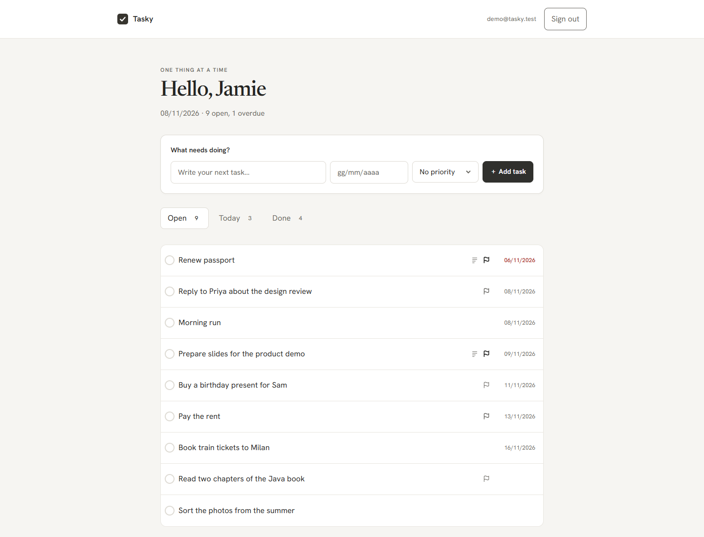
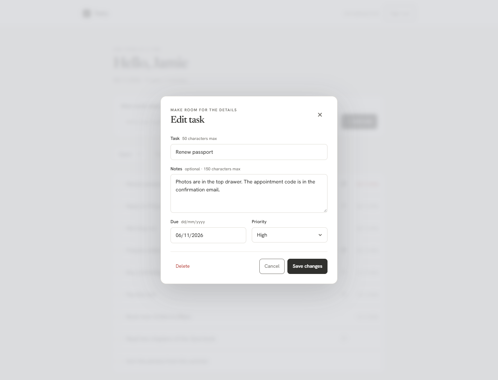

# Tasky

[](https://github.com/krishnapilato/tasky/actions/workflows/build.yml)
[](https://github.com/krishnapilato/tasky/actions/workflows/security.yml)
[](https://github.com/krishnapilato/tasky/actions/workflows/pages.yml)

Project started in late 2021 with java 11 EE and MySQL. Unfortunately it was abandoned, to focus on work.
Today, after 5 years, I am proudly announcing a very updated version of that project with latest versions as possible.
A small task list. Sign in, add tasks with a due date and a priority, and tick them off.

**[Live demo](https://krishnapilato.github.io/tasky/)** · runs in the browser with sample data





## What it does

- Sign up, sign in and sign out
- Add, edit, finish and delete tasks
- Due dates shown and entered as `dd/mm/yyyy`, with overdue tasks shown in red
- Three priority levels
- Filters for open tasks, tasks due today and finished tasks
- Titles up to 50 characters and notes up to 150, validated before submission and again by the backend
- New tasks cannot be due in the past, using the browser time zone on both backends
- Field errors, keyboard focus, mobile layouts, duplicate-submit protection and confirmation before deleting

## Built with

- Java 27 with [Javalin](https://javalin.io) 7 on Jetty, running on virtual threads
- [JDBI](https://jdbi.org) 3 with an in-memory H2 database
- Jackson 3 for JSON and password4j for Argon2id password hashes
- Pico CSS, Alpine.js CSP and Valibot, served locally as pinned assets
- Native HTML dialogs and JavaScript modules; deployment needs no frontend build

There is no Spring in this project. The reasons behind this and other choices are in [docs/decisions.md](docs/decisions.md).

## Run it

You need JDK 27 and Maven.

```bash
mvn package
```

```bash
java -jar target/tasky.jar
```

Open <http://localhost:8080> and click **Try the demo account**, or create your own account.

The database lives in memory and is filled from [`seed.json`](src/main/resources/web/data/seed.json) on every start, so a restart resets everything. To use another port, set the `PORT` environment variable.

With Docker:

```bash
docker build -t tasky .
```

```bash
docker run --rm -p 8080:8080 tasky
```

## How the demo works without a server

GitHub Pages only serves files, so the Java code cannot run there.

When the page loads it asks for `api/account`. The Java server answers that request itself. On GitHub Pages the same address is a small file that says `"demo": true`, and the page then uses [`demo.js`](src/main/resources/web/js/demo.js) instead of the server. It has the same routes and the same messages as the Java API, but keeps the data in `localStorage`. Both versions load the same `seed.json`.

## API

| Method | Path | What it does |
| --- | --- | --- |
| `GET` | `/api/account` | Tells who is signed in |
| `POST` | `/api/account/register` | Creates an account and signs in |
| `POST` | `/api/account/login` | Signs in |
| `POST` | `/api/account/logout` | Signs out |
| `GET` `POST` | `/api/tasks` | Lists or adds tasks |
| `PUT` `DELETE` | `/api/tasks/{id}` | Changes or deletes a task |

Errors come back as `{"message": "..."}`. For POST, PUT and DELETE, send `X-Tasky-Request: 1`. Send POST/PUT bodies as `application/json`. Task writes may include `X-Time-Zone` with an IANA zone such as `Europe/Rome`; without it, date validation uses UTC.

## Security

- Passwords are stored as Argon2id hashes with OWASP settings.
- Sign-in is blocked for ten minutes after eight failed attempts on the same email.
- The session cookie is `HttpOnly` and `SameSite=Strict`, and the session id changes at sign-in.
- Request bodies are limited to 16 KB. JSON types, unknown fields, trailing content, IDs and text lengths are checked on the server.
- State-changing API requests require `X-Tasky-Request: 1`; cross-origin browser requests are rejected, and POST/PUT bodies must use `application/json`. API responses use `Cache-Control: no-store`.
- Sessions expire after 30 minutes of inactivity.
- Every response carries `X-Content-Type-Options`, `X-Frame-Options`, `Referrer-Policy` and `Permissions-Policy` headers.
- The page has a Content Security Policy. Pico, Alpine and Valibot are local, version-pinned assets with integrity hashes. Only the fonts load from an external service.
- The policy enforces Trusted Types. User content is rendered through Alpine `x-text`, never `x-html`. Application code uses DOM methods and templates, and ESLint forbids `innerHTML`, `eval` and `new Function`.
- Right-click menus and text selection are disabled in the interface. Inputs remain selectable for editing. These UI preferences are not security controls.
- The Docker image runs as an unprivileged user.

## Lighthouse

Measured on the sign-in page, on both the Java server and the GitHub Pages version:

| | Performance | Accessibility | Best practices | SEO |
| --- | --- | --- | --- | --- |
| Desktop | 100 | 100 | 100 | 100 |
| Mobile | 99 | 100 | 100 | 100 |

The Lighthouse workflow fails if performance drops below 90 or any other score drops below 100.

## Checks and tests

Every push and pull request runs one workflow per check. GitHub Pages is only updated when Build, Lint, UI tests and Lighthouse all pass, so a broken commit never reaches the live demo.

| Workflow | What it checks | Fails on |
| --- | --- | --- |
| Build | `mvn verify`: Maven Enforcer, the Java compiler with every lint warning on, PMD, then a smoke test of the real JAR on a non-default `PORT` | Java older than 27, conflicting, duplicate or dynamic dependency versions, unpinned plugins, any compiler warning, an unused variable, import, field or method, common bug patterns, a failing endpoint or missing security header, any warning in the server log |
| Lint | ESLint with SonarSource's rules for the JavaScript, tests and configuration, Stylelint for the CSS, and actionlint with shellcheck for the workflows | Any warning, including an unused variable or import, `innerHTML`, `eval` and the issues SonarLint reports |
| UI tests | Playwright drives the whole app in Chrome against the Java server and against the GitHub Pages version | A broken screen or action, a validation rule that differs between the two versions, and any console error, CSP violation or integrity failure |
| Lighthouse | Desktop and mobile audits of both versions | The scores above dropping |
| Docker | Builds the image, starts it read-only without capabilities and calls it | A failing build or start, a container running as root or needing to write outside `/tmp`, warnings in its log |
| Security | CodeQL for the Java, the JavaScript and the workflows, `npm audit` with registry signatures, and dependency review on pull requests | Known vulnerabilities of any severity, a package without a valid registry signature |

Every workflow runs on Java 27 and Node.js 26, and `npm ci` refuses an older Node.js because of `engine-strict` in `.npmrc`.

Dependabot opens a pull request every week for new Maven, npm and GitHub Actions versions, and those pull requests go through the same checks.

Frontend dependencies are generated once and committed, so Java, Docker and GitHub Pages serve the same files without Node at runtime. After updating a frontend package, run `npm run sync:assets` and commit the generated assets and import-map hashes. Lint rejects stale assets. The script also preserves dependency licenses and contains a documented Alpine workaround for deprecated advertising API getters in Chrome.

Run the same checks locally:

```bash
mvn verify
```

```bash
npm ci && npm run lint
```

```bash
npm run test:ui
```

The UI tests start the Java server and the Pages version on their own. They use Microsoft Edge on Windows and Chrome elsewhere, so no browser download is needed.

## Project layout

```text
src/main/java/io/github/krishnapilato/tasky
├── Tasky.java        starts the app
├── Routes.java       routes, security headers and errors
├── Store.java        database schema and queries
├── Seed.java         loads the sample account and tasks
└── model/            User, Task and Priority

src/main/resources/web
├── index.html
├── vendor/          generated, pinned frontend dependencies
├── css/app.css
├── data/seed.json    sample data for both versions
├── api/account       tells the page it runs without a server
└── js/
    ├── app.js        the page logic
    ├── api.js        talks to the server or to demo.js
    ├── validation.js shared frontend and demo validation
    └── demo.js       replaces the server on GitHub Pages

docs/decisions.md     why it is built this way

tests
├── app.spec.js       Playwright test of the whole app
├── security.spec.js  validation, hostile requests, ownership and recovery
├── lighthouse.js     Lighthouse audit with minimum scores
└── pages-server.js   serves the web folder like GitHub Pages
```
