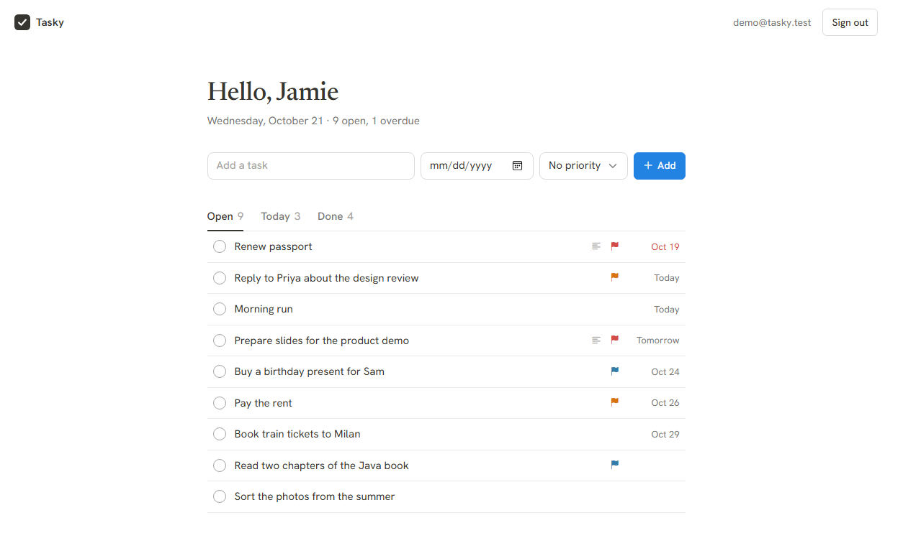
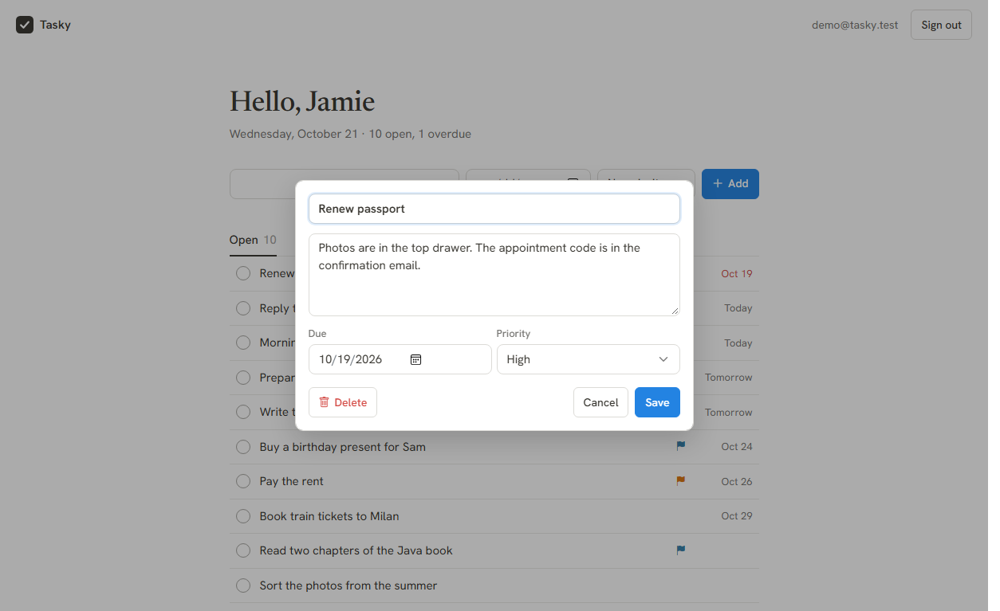

# Tasky

[](https://github.com/krishnapilato/tasky/actions/workflows/build.yml)
[](https://github.com/krishnapilato/tasky/actions/workflows/lint.yml)
[](https://github.com/krishnapilato/tasky/actions/workflows/ui.yml)
[](https://github.com/krishnapilato/tasky/actions/workflows/lighthouse.yml)
[](https://github.com/krishnapilato/tasky/actions/workflows/docker.yml)
[](https://github.com/krishnapilato/tasky/actions/workflows/security.yml)
[](https://github.com/krishnapilato/tasky/actions/workflows/pages.yml)
[](.github/dependabot.yml)

A small task list. Sign in, add tasks with a due date and a priority, and tick them off.

**[Live demo](https://krishnapilato.github.io/tasky/)** · runs in the browser with sample data





## What it does

- Sign up, sign in and sign out
- Add, edit, finish and delete tasks
- Due dates, with overdue tasks shown in red
- Three priority levels
- Filters for open tasks, tasks due today and finished tasks
- New tasks cannot be due in the past, checked the same way by the server and the demo

## Built with

- Java 27 with [Javalin](https://javalin.io) 7 on Jetty, running on virtual threads
- [JDBI](https://jdbi.org) 3 with an in-memory H2 database
- Jackson 3 for JSON and password4j for Argon2id password hashes
- Bootstrap 6 and modern JavaScript modules, without a build step

There is no Spring in this project.

## Run it

You need JDK 27 and Maven.

```bash
mvn package
```

```bash
java -jar target/tasky.jar
```

Open <http://localhost:8080> and click **Try the demo account**, or create your own account.

The database lives in memory and is filled from [`seed.json`](src/main/resources/web/data/seed.json) on every start, so a restart resets everything. To use another port, set the `PORT` environment variable.

With Docker:

```bash
docker build -t tasky .
```

```bash
docker run --rm -p 8080:8080 tasky
```

## How the demo works without a server

GitHub Pages only serves files, so the Java code cannot run there.

When the page loads it asks for `api/account`. The Java server answers that request itself. On GitHub Pages the same address is a small file that says `"demo": true`, and the page then uses [`demo.js`](src/main/resources/web/js/demo.js) instead of the server. It has the same routes and the same messages as the Java API, but keeps the data in `localStorage`. Both versions load the same `seed.json`.

## API

| Method | Path | What it does |
| --- | --- | --- |
| `GET` | `/api/account` | Tells who is signed in |
| `POST` | `/api/account/register` | Creates an account and signs in |
| `POST` | `/api/account/login` | Signs in |
| `POST` | `/api/account/logout` | Signs out |
| `GET` `POST` | `/api/tasks` | Lists or adds tasks |
| `PUT` `DELETE` | `/api/tasks/{id}` | Changes or deletes a task |

Errors come back as `{"message": "..."}`.

## Security

- Passwords are stored as Argon2id hashes with OWASP settings.
- Sign-in is blocked for ten minutes after eight failed attempts on the same email.
- The session cookie is `HttpOnly` and `SameSite=Strict`, and the session id changes at sign-in.
- Request bodies are limited to 16 KB.
- Every response carries `X-Content-Type-Options`, `X-Frame-Options`, `Referrer-Policy` and `Permissions-Policy` headers.
- The page has a Content Security Policy, and every file from the CDN is pinned with a Subresource Integrity hash, including the Bootstrap script loaded through the import map.
- The policy enforces Trusted Types, so the browser itself refuses any attempt to insert HTML from a string. The code only uses `textContent` and templates, and ESLint forbids `innerHTML`, `eval` and `new Function`.
- The Docker image runs as an unprivileged user.

## Lighthouse

Measured on the sign-in page, on both the Java server and the GitHub Pages version:

| | Performance | Accessibility | Best practices | SEO |
| --- | --- | --- | --- | --- |
| Desktop | 100 | 100 | 100 | 100 |
| Mobile | 97 to 98 | 100 | 100 | 100 |

The Lighthouse workflow fails if performance drops below 90 or any other score drops below 100.

## Checks and tests

Every push and pull request runs one workflow per check, and each has a badge at the top of this page. GitHub Pages is only updated when Build, Lint, UI tests and Lighthouse all pass, so a broken commit never reaches the live demo.

| Workflow | What it checks | Fails on |
| --- | --- | --- |
| Build | `mvn verify`: Maven Enforcer, the Java compiler with every lint warning on, PMD, then a smoke test of the real JAR | Java older than 27, conflicting or duplicate dependency versions, unpinned plugins, any compiler warning, an unused variable, import, field or method, common bug patterns, a failing endpoint or missing security header, any warning in the server log |
| Lint | ESLint with SonarSource's rules for the JavaScript, tests and configuration, Stylelint for the CSS, and actionlint with shellcheck for the workflows | Any warning, including an unused variable or import, `innerHTML`, `eval` and the issues SonarLint reports |
| UI tests | Playwright drives the whole app in Chrome against the Java server and against the GitHub Pages version | A broken screen or action, a validation rule that differs between the two versions, and any console error, CSP violation or integrity failure |
| Lighthouse | Desktop and mobile audits of both versions | The scores above dropping |
| Docker | Builds the image, starts it and calls it | A failing build or start, a container running as root, warnings in its log |
| Security | CodeQL for the JavaScript and the workflows, `npm audit`, and dependency review on pull requests | Known vulnerabilities of moderate severity or higher |

Dependabot opens a pull request every week for new Maven, npm and GitHub Actions versions, and those pull requests go through the same checks.

Run the same checks locally:

```bash
mvn verify
```

```bash
npm ci && npm run lint
```

```bash
npm run test:ui
```

The UI tests start the Java server and the Pages version on their own. They use Microsoft Edge on Windows and Chrome elsewhere, so no browser download is needed.

## Project layout

```text
src/main/java/io/github/krishnapilato/tasky
├── Tasky.java        starts the app
├── Routes.java       routes, security headers and errors
├── Store.java        database schema and queries
├── Seed.java         loads the sample account and tasks
└── model/            User, Task and Priority

src/main/resources/web
├── index.html
├── css/app.css
├── data/seed.json    sample data for both versions
├── api/account       tells the page it runs without a server
└── js/
    ├── app.js        the page logic
    ├── api.js        talks to the server or to demo.js
    └── demo.js       replaces the server on GitHub Pages

tests
├── app.spec.js       Playwright test of the whole app
├── lighthouse.js     Lighthouse audit with minimum scores
└── pages-server.js   serves the web folder like GitHub Pages
```
